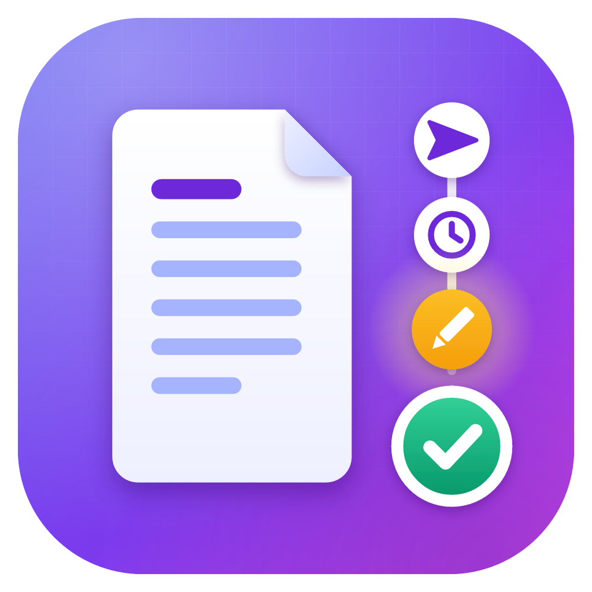
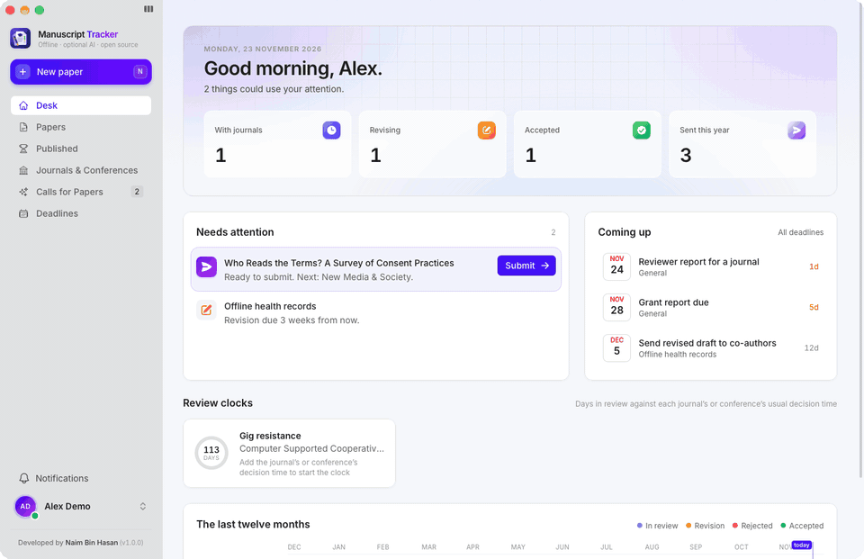
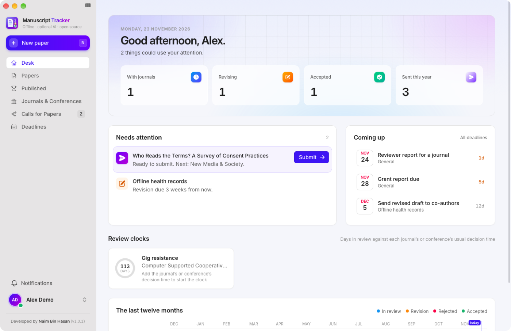
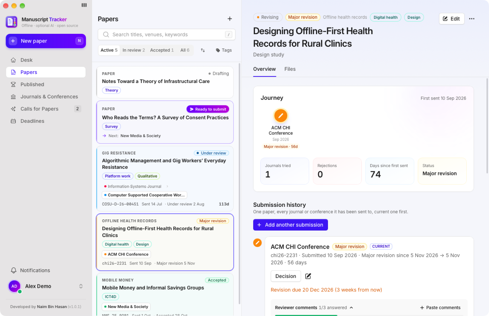
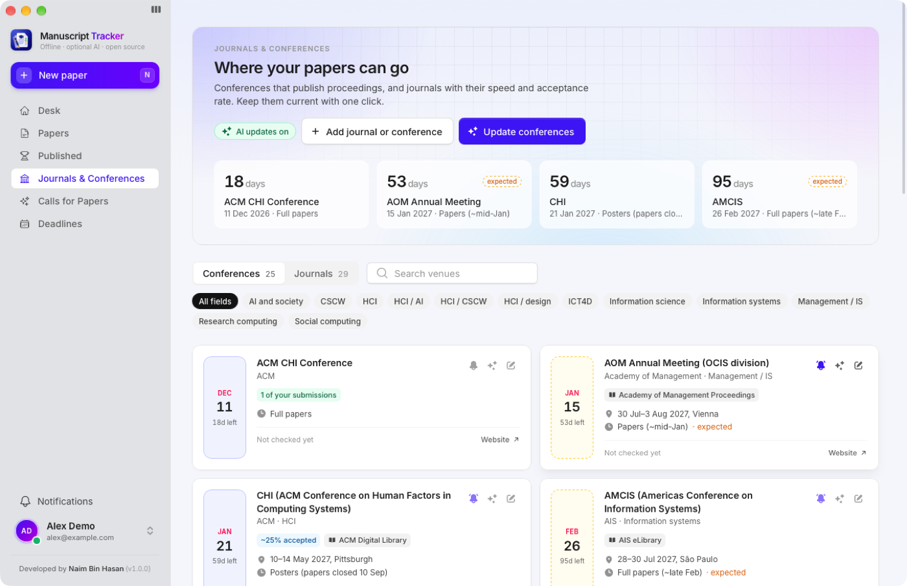
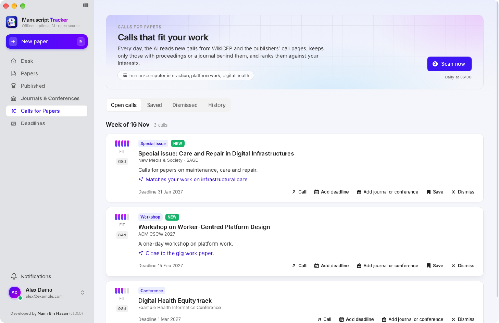

  

<h1 align="center">Manuscript Tracker — offline-first desktop manuscript and journal submission tracker</h1>

<strong>Track your manuscript submissions with ease.</strong> Fully offline, optional AI, free and open source.

Manuscript Tracker is a free and open-source desktop app for PhD students, postdocs and researchers who want one private place to track their academic papers. Use it as a manuscript tracker and journal submission tracker: record where each paper was submitted, follow its peer review status and editor decisions, answer reviewer comments, and never miss a revision deadline or a call for papers. It runs natively on Mac (fully tested), Windows and Linux (both experimental), works fully offline, keeps your data private on your own computer, and exports open backups you can take anywhere.

  

## Web or desktop?

| | Where it runs | Your data |
| --- | --- | --- |
| [Web version](https://github.com/naimbh/manuscript-tracker) | A self-hosted online app you run on a server and open in a browser | On your server |
| Desktop app (this repository) | Installed on your Mac, Windows or Linux computer, fully offline | Only on your computer |

AI features in the desktop app are optional and only go online when you use them. Data moves easily both ways: export a backup from one app (in the web app, **Backup & calendar → Download backup**; in the desktop app, **Settings → Backup & calendar**) and import it in the other.

## Screenshots

### Papers and submission history

  
  

The screenshots show fictional demo data.

## Features

- **Papers and submissions.** Track every manuscript from first draft to publication, with co-authors and CRediT roles, files, keywords and notes.
- **Peer review status.** Record each journal or conference submission with its manuscript ID, portal link, status and editor decision, and see a paper’s whole journey at a glance. Each submission keeps a dated timeline of its statuses (submitted, with the editor, under review, decision) and shows how many days each step took.
- **Review clocks.** See how long each paper has been under review compared with the journal’s or conference’s usual decision time.
- **Revisions and deadlines.** Answer reviewer comments one by one, track revision due dates, and keep conference deadlines in one list with a calendar feed.
- **Journals & Conferences.** A library of journals and conferences with deadlines, decision times, acceptance rates, review type, fees and word limits, plus a queue of where each paper goes next.
- **Calls for Papers.** A daily scan finds calls and special issues that fit your research, each with a fit score and a short reason.
- **Published work and citations.** Citation counts from OpenAlex, Crossref, Semantic Scholar and your Google Scholar profile, with your h-index and i10-index.
- **AI research with sources.** The app fetches journal and conference pages and scholarly databases itself; the AI only reads what was fetched, cites a source and a quote for every value, and changes nothing until you approve it. Works with Claude Code, Anthropic, OpenAI, Gemini and local models.
- **Open backups.** Export everything, including attached files, as a `.zip` or `.json` file that also works with the web version. Daily local copies are kept automatically.
- **MCP for AI agents.** A built-in local MCP server lets AI assistants read and update your tracker, with no token and no open network port.
- **Your profile.** Add a profile photo and crop, zoom or rotate it in the app.
- **Automatic updates.** New versions are checked for once a day and install with one click when you restart.
- **Native desktop app.** Menu bar, keyboard shortcuts, command palette (⌘K or Ctrl+K), notifications, tray icon, drag-and-drop attachments, an Always on Top option, and light and dark modes.

## Download

> **Platform status:** the macOS version is fully tested. The Windows and Linux versions are experimental: they are built from the same code and should work, but they have not been tested as thoroughly. Please [report any problems](https://github.com/naimbh/manuscript-tracker-desktop/issues).

| System | Download |
| --- | --- |
| macOS 11 or later (Apple silicon and Intel) | [Manuscript.Tracker_1.0.3_universal.dmg](https://github.com/naimbh/manuscript-tracker-desktop/releases/latest/download/Manuscript.Tracker_1.0.3_universal.dmg) |
| Windows 10 or 11 | [Manuscript.Tracker_1.0.3_x64-setup.exe](https://github.com/naimbh/manuscript-tracker-desktop/releases/latest/download/Manuscript.Tracker_1.0.3_x64-setup.exe) or [Manuscript.Tracker_1.0.3_x64_en-US.msi](https://github.com/naimbh/manuscript-tracker-desktop/releases/latest/download/Manuscript.Tracker_1.0.3_x64_en-US.msi) |
| Linux | [AppImage](https://github.com/naimbh/manuscript-tracker-desktop/releases/latest/download/Manuscript.Tracker_1.0.3_amd64.AppImage), [.deb](https://github.com/naimbh/manuscript-tracker-desktop/releases/latest/download/Manuscript.Tracker_1.0.3_amd64.deb) (Debian, Ubuntu) or [.rpm](https://github.com/naimbh/manuscript-tracker-desktop/releases/latest/download/Manuscript.Tracker-1.0.3-1.x86_64.rpm) (Fedora, openSUSE) |

All downloads: [Releases page](https://github.com/naimbh/manuscript-tracker-desktop/releases/latest)

### First launch

The app is not signed with an Apple Developer or Windows code-signing certificate yet, so your system may block the first launch. You only need to allow it once.

- **macOS:** open **System Settings → Privacy & Security**, scroll down to the message about Manuscript Tracker and click **Open Anyway**, then confirm. (Or right-click the app in Applications, choose **Open** and confirm.)
- **Windows:** if SmartScreen says “Windows protected your PC”, click **More info**, then **Run anyway**.
- **Linux:** make the AppImage executable (`chmod +x Manuscript.Tracker_1.0.3_amd64.AppImage`), or install the `.deb` or `.rpm` with your package manager.

## Move your data from the web app

In the web app, open **Backup & calendar** and click **Download backup (.zip with files)**. In the desktop app, open **Settings → Backup & calendar** and click **Import backup…**, or choose **Restore from a backup** on the welcome screen. Importing only adds records and never deletes anything.

## For developers

## Licence

Free and open source under the [GNU AGPL v3.0](LICENSE) (AGPL-3.0-or-later). Copyright © 2026 Naim Bin Hasan.

Made by [Naim Bin Hasan](https://naimbh.com/dev). Also available as a self-hosted [web app](https://github.com/naimbh/manuscript-tracker), which has its own licence.
